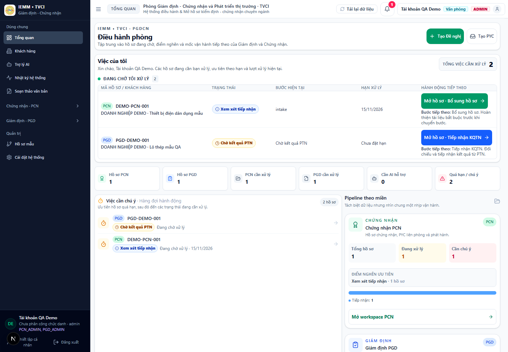
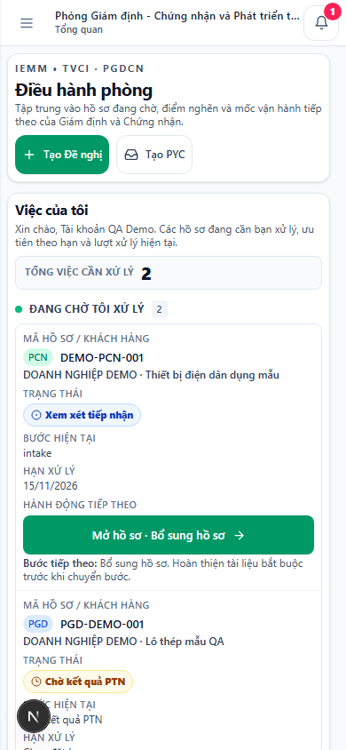
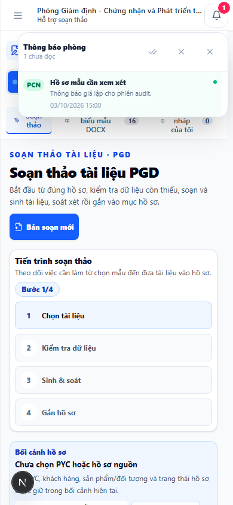
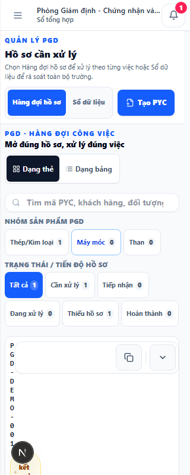
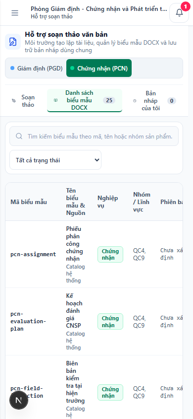

# Audit UI/UX PGDCN sau xác thực QA — 2026-10-27

## Kết quả

Đã chạy browser Chromium thật trên QA preview và kiểm tra các màn hình sau session synthetic: **37 trạng thái màn hình, 113 ảnh Playwright, 56 thao tác/ghi nhận**. Coverage gồm admin, nhân sự có scope PCN+PGD và viewer PCN-only; mỗi màn hình chính có ảnh 1440×1000 và 390×844. Bảy nhóm rủi ro cao được chụp thêm ở 320, 375, 430, 768 và 1280 px.

Không tìm thấy P0/P1. Có **4 findings P2 và 1 P3** cần ưu tiên. DOM không có tràn ngang ở cấp document/body trong 113 ảnh; một số bảng có vùng cuộn ngang nội bộ. Không có JavaScript page error sau khi fixture được hoàn thiện. Hai lỗi console 401 là kết quả được chủ ý tạo cho màn hình login trước session.

## Phạm vi và cách xác thực

- Đọc các phần liên quan của `design.md`: ranh giới navigation/shared shell và yêu cầu responsive/accessibility §5A. Audit chỉ ghi nhận, không cập nhật quyết định thiết kế.
- Docker app đang nghe ở localhost:2357 được phát hiện nhưng không dùng dữ liệu hoặc session của container đó. QA preview riêng chạy trên `127.0.0.1:2367`.
- Không có phiên browser đã xác thực và không dùng thông tin đăng nhập thật. Ảnh login trước session dùng route API trả 401 có chủ ý. Sau đó Playwright mock session/API bằng fixture tổng hợp; toàn bộ request `/api/*` được route trong browser context, request ra ngoài origin sẽ bị chặn.
- PostgreSQL và dịch vụ ngoài được trỏ về địa chỉ giả không hoạt động; không truy vấn hay ghi database. Kết quả Playwright ghi **0 API mutation** và **0 request ra ngoài origin được thử**.
- Đã mở form tạo khách hàng, form nhập Excel, preview, export, intake PYC, tạo bộ hồ sơ mẫu và form thêm user chỉ để chụp; các form đều đóng/hủy. Không xác nhận nhập Excel, không export, không tạo PYC/user/template; panel backup chỉ đọc.
- Tệp Excel là workbook synthetic tạo trong bộ nhớ trình duyệt. Fixture dùng tên/mã `DEMO`/`QA`, không có dữ liệu khách hàng thật.
- **Coding engine: Codex fallback.** Đã gọi AGY qua helper một lần theo contract; helper trả `SUCCEEDED` nhưng chỉ diễn giải lại yêu cầu rồi xin xác nhận lần nữa, dù người dùng đã xác nhận rõ. AGY không tạo runner hay artifact, nên Codex tiếp tục bằng Playwright QA harness.

### Ảnh tổng quan và các trạng thái chính

Ma trận đầy đủ từng route, mode, role, viewport, screenshot, thao tác và số đo DOM: [2026-10-27-coverage-matrix.md](2026-10-27-coverage-matrix.md). File evidence Playwright dạng JSON: [runtime-evidence.json](artifacts/runtime-evidence.json).

## Findings

| ID | Mức | Finding | Bằng chứng thực tế |
|---|---|---|---|
| F1 | P2 | Panel thông báo còn phủ màn hình sau khi đổi mục điều hướng. | Mở chuông ở Nhật ký, bấm sang Soạn thảo; dialog vẫn mở ở cả 1440 và 390 px (`dialog=1`). [Ảnh desktop](artifacts/admin/notification-after-route-change-desktop-1440x1000.png), [ảnh mobile](artifacts/admin/notification-after-route-change-mobile-390x844.png). |
| F2 | P2 | Preview nhập Excel nhìn như modal nhưng không có ngữ nghĩa dialog trong DOM. | Preview được mở bằng workbook synthetic và hủy; Playwright đo `dialog=0` ở 1440 và 390 px dù nền bị làm mờ, có nút đóng/hủy. [Ảnh preview mobile](artifacts/admin/customer-import-preview-mobile-390x844.png). |
| F3 | P2 | Mã PYC trong thẻ hàng đợi PGD bị xuống dòng từng ký tự trên màn hình hẹp, khó đọc và khó chọn đúng hồ sơ. | Thấy ở 320, 375, 390 và 430 px; `overflow=0`, nhưng mã `PGD-DEMO-001` hiển thị thành cột ký tự. [Ảnh 320 px](artifacts/admin/pgd-register-narrow-320x800.png), [ảnh 390 px](artifacts/admin/pgd-register-mobile-390x844.png). |
| F4 | P2 | Từ chi tiết hồ sơ PCN, bấm “Sổ dữ liệu PCN” đưa người dùng về danh sách “Quản lý Đề nghị”. | Playwright mở `DEMO-PCN-001`, bấm mục menu, rồi ghi nhận URL `/pgdcn/pcn` nhưng heading vẫn là “Quản lý Đề nghị”, không phải “Sổ tổng hợp PCN”. Điều hướng ổn định được tiếp tục sau khi quay về shell. [Ảnh sau click trực tiếp](artifacts/admin/pcn-register-direct-from-detail-desktop-1440x1000.png). |
| F5 | P3 | Danh sách mẫu DOCX PCN quá chật ở mobile: mã và tiêu đề bị chia thành nhiều dòng ngắn, làm chậm việc quét danh sách. | 390 px dùng vùng cuộn ngang (`scroll-x=1`) nhưng nhiều cột vẫn wrap mạnh; không tràn document. [Ảnh mẫu DOCX PCN mobile](artifacts/admin/document-templates-list-pcn-mobile-390x844.png). |

### Một số ảnh finding

## Phương án cải thiện theo 3 pha

Các hạng mục dưới đây là đề xuất, chưa triển khai. Mỗi task giới hạn 1–2 file; tiêu chí Playwright nêu rõ để chuyển thành ticket có thể nghiệm thu. Bám contract hiện tại trong `design.md`: menu theo scope, màn hình tiếng Việt, modal có tên/ngữ nghĩa/focus rõ, và layout 320–430 px không tràn ngang.

### Pha 1 — Giảm rối và xử lý lỗi thấy ngay

1. **F1 · Đóng panel thông báo khi chuyển mục** — `components/PgdcnAppShell.tsx`, `components/PgdcnNotificationDropdown.tsx`. Khi section thay đổi, đóng popup và cập nhật `aria-expanded`; không để overlay nằm trên nội dung đích. **Playwright:** mở chuông → bấm “Soạn thảo văn bản” → dialog ẩn, nút chuông `aria-expanded=false`, focus ở menu đích hoặc trở về trigger hợp lệ.
2. **F2 · Chuẩn hóa preview Excel thành dialog có thể dùng bàn phím** — `components/PcnCustomersManagementView.tsx`. Gắn role/label/`aria-modal`, quản lý focus khi mở/đóng, hỗ trợ Escape và giữ nút xác nhận/hủy rõ ràng. **Playwright:** nạp workbook synthetic → `getByRole('dialog', {name: ...})` thấy được, focus nằm trong dialog, Escape đóng và focus trở về nút mở; không phát sinh import.
3. **F3 · Giữ mã PYC đọc được ở 320–430 px** — `components/PgdDossierQueueView.tsx`. Bố trí mã/quick actions bằng flex sizing có giới hạn hợp lý; không cho mã nghiệp vụ bị bẻ từng ký tự. **Playwright:** ở 320/375/390/430, mã có một dòng hoặc dạng wrap có chủ đích, không có dòng một ký tự; nút “Mở hồ sơ” cao tối thiểu 44 px, body không tràn ngang.

### Pha 2 — Chuẩn hóa primitives, navigation và layout

1. **F5 · Thiết kế lại hàng mẫu DOCX cho mobile** — `components/PgdcnUnifiedDraftingView.tsx`. Tách card mobile hoặc đặt `min-width`/scroll rõ ràng cho bảng; giữ mã mẫu, phiên bản, trạng thái và thao tác tải/dùng có thể quét được. **Playwright:** PCN và PGD tại 320/375/390/430; mã mẫu không wrap theo từng ký tự, các thao tác còn truy cập được, không có body overflow.
2. **Phủ kiểm tra dialog/focus trên các form nổi dùng chung** — tối đa `components/PgdcnUiPrimitives.tsx` và một component caller trong mỗi PR nhỏ. Ưu tiên dùng cùng contract cho dialog, sheet và form inline; không buộc nội dung dài vượt safe area. **Playwright:** mở/đóng các form khách hàng, intake, user admin ở desktop/mobile; kiểm tra role/name, focus visible, nút đóng và không che CTA khi cuộn.
3. **Giảm badge và hành động phụ cạnh CTA chính** — mỗi màn hình là task riêng trong `PcnWorkspace.tsx` hoặc `PgdWorkspace.tsx`. Giữ trạng thái và bộ lọc cần quyết định ở đầu, chuyển các bộ lọc hiếm dùng vào vùng thu gọn. **Playwright:** kiểm tra màn hình 390 và desktop; CTA chính được nhận biết trong 3 giây theo heuristic kiểm duyệt, không mất filter đang áp dụng.

### Pha 3 — Cải thiện sâu workflow PCN/PGD

1. **F4 · Giữ đúng section sau khi đóng/ngữ cảnh dossier PCN** — `components/PgdcnAppShell.tsx`. Khi điều hướng từ canonical dossier route, giữ target người dùng chọn thay vì remount về section mặc định. **Playwright:** mở hồ sơ PCN → bấm Sổ dữ liệu PCN → heading “Sổ tổng hợp PCN” và trạng thái menu trùng nhau; browser back/forward tiếp tục đúng context.
2. **PCN: nối liền hồ sơ → register → mẫu/PTN → KPI** — các PR nhỏ 1–2 file, bắt đầu với `components/PcnWorkspace.tsx` và `components/PcnSampleFlowView.tsx`. **Playwright:** mở một fixture hồ sơ, đi qua register/mẫu/PTN rồi quay lại; cùng dossier ID được giữ, trạng thái mẫu/KQTN được truy cập, không gọi API mutation.
3. **PGD: nối hàng đợi → PYC → chi tiết bước → sổ mẫu/KQTN** — các PR nhỏ 1–2 file, tập trung `components/PgdWorkspace.tsx` và `components/PgdDossierQueueView.tsx`. **Playwright:** mở `PGD-DEMO-001`, chọn bước hiện tại, tới Sổ dữ liệu và Sổ mẫu/PTN; kiểm tra bước/chủ hồ sơ không đổi ngoài ý muốn ở 320, 390 và 1440 px.

## Giới hạn của lượt audit

- Tất cả nội dung sau login là `QA_MOCKED`; chưa kiểm tra REAL_AUTH, cookie thật hay quyền trên dữ liệu production. Ba role chỉ là fixture admin, staff PCN+PGD và viewer PCN-only; chưa bao phủ mọi tổ hợp role/domain.
- Mỗi miền chỉ dùng một hồ sơ và một khách hàng synthetic. Dữ liệu dài, nhiều trang, nhiều lỗi import, xung đột dữ liệu, lỗi mạng/empty/loading có chủ ý và trạng thái API chậm chưa được kích hoạt đầy đủ.
- Trợ lý AI chỉ được mở màn hình; không gửi prompt hay gọi model. Backup và export chỉ mở/đọc rồi hủy; không kiểm tra tác động tải file thật.
- Ảnh chụp từ Next dev còn badge “N” của tooling ở góc trái; đây không thuộc giao diện sản phẩm.
- `runtime-evidence.json` có 2 console 401 tại màn hình baseline login theo kịch bản; không có JavaScript page error trong lượt cuối.

## Rollback QA và file thay đổi

Không chỉnh auth/session/RBAC, cấu hình production, database hay UI sản phẩm. Session QA chỉ tồn tại trong Playwright route interception. Next dev QA tại `127.0.0.1:2367` đã dừng; không còn listener ở port này. Runner và prompt C2C tạm đã xóa. Giữ lại reports, matrix, JSON evidence và ảnh để người dùng kiểm tra. Docker container ở 2357 vẫn chạy, không bị sửa/rebuild/redeploy. Không commit/push. `AGENTS.md`, `next.config.mjs` cùng hai plan dưới `docs/superpowers/plans/` là trạng thái có sẵn trước task; audit không sửa các file đó.

